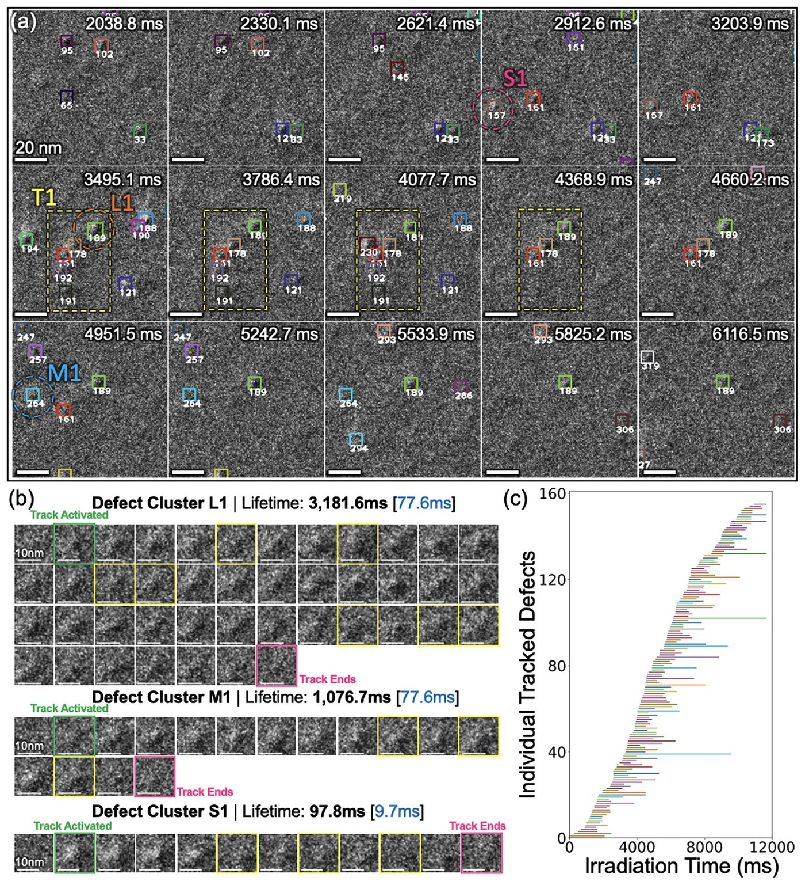
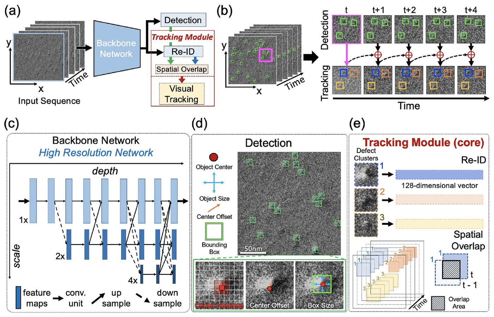

# DefectTrack

Code and pretrained model for **DefectTrack**, a multi-object tracker for defect
clusters in in-situ irradiation TEM videos.

[Paper](https://doi.org/10.1038/s41598-022-19697-1) | [Model and data (figshare)](https://figshare.com/s/9e7f6c0870e828dbc1a2) | [Citation](#citation) | [Related: DefectSegNet](https://github.com/rajatsainju2025/DefectSegNet)

<p align="center">
  
</p>

During in-situ ion irradiation, defect clusters appear, move and disappear within
milliseconds. Measuring how long each one survives means following hundreds of
small, low-contrast objects through thousands of frames, which is slow and
inconsistent by hand. DefectTrack detects every cluster in each frame and links
the detections over time, so each defect keeps one ID for its whole lifetime.
On the test set (1 MeV Kr²⁺ irradiation of Ni at 700 °C) it reaches a MOTA of
66.43% and an MT of 67.81%. When measuring defect lifetime distributions, it
was both more accurate and faster than four human experts.

*Above: tracked clusters in a 256 × 256 crop (a), three clusters with long,
medium and short lifetimes (b), and the lifetimes of all tracked clusters (c).
Fig. 6 in the paper.*

## Model

DefectTrack is a one-shot tracker in the style of FairMOT. An HRNet-18 backbone
feeds two heads. One predicts each cluster's center, size and offset. The other
produces a 128-d re-identification embedding. Tracks are then associated from
frame to frame using the embeddings, a Kalman-filter motion model and box overlap.

<p align="center">
  
</p>

*(a) Overall pipeline, (b) tracking by detection and association, (c) HRNet
backbone, (d) detection branch, (e) tracking module. Fig. 3 in the paper.*

## Getting started

```bash
git clone https://github.com/rajatsainju2025/DefectTrack.git
cd DefectTrack
pip install .
python scripts/download_weights.py      # model from figshare -> weights/best.pth

defecttrack data/video_sample/images --video
```

Results go to `results/<sequence>/`:

- `results.txt`: one box per line as `frame,id,x,y,w,h,score,1,-1,-1,-1` (MOTChallenge format)
- `frames/`: frames with each tracked cluster boxed and labelled by ID
- `tracking.mp4`: the same frames as a video (only with `--video`)

To run on your own data, export the video as numbered frames and pass that
folder instead. Frames are resized and padded to 1024 × 512, the input size used
in training. The main options are `--conf-thres` (default 0.3), `--frame-rate`
(default 100, which sets how long a lost track is kept) and `--device`. See
`defecttrack --help` for the rest. The code runs on CPU or GPU.

The tracker can also be called from Python:

```python
from defecttrack.config import TrackerConfig
from defecttrack.tracking import track_sequence

cfg = TrackerConfig(load_model="weights/best.pth")
track_sequence(cfg, "data/video_sample/images", "results/video_sample")
```

A Dockerfile is included as well:

```bash
docker build -t defecttrack .
docker run --rm -v "$PWD/results:/results" defecttrack
```

## Model and data

The pretrained model and the training data are on figshare:

- [DefectTrack_model.zip](https://figshare.com/s/9e7f6c0870e828dbc1a2?file=35106460)
  (84 MB): the checkpoint (`best.pth`). `scripts/download_weights.py`
  fetches it and extracts the checkpoint for you.
- [DefectTrack_TrainingData.zip](https://figshare.com/s/9e7f6c0870e828dbc1a2?file=35106187)
  (4.2 GB): the in-situ TEM video frames used for training, with ground-truth
  tracks (`gt.txt`) and the VIA annotation file.

## Repository layout

```
defecttrack/   package: model, tracker, data loading, CLI
data/          10-frame sample sequence
scripts/       weight download
tests/         quick tests (no weights needed): pytest -q
```

This repository covers inference. Training followed the
[FairMOT](https://github.com/ifzhang/FairMOT) recipe with an HRNet-18 backbone;
details are in the paper.

## Acknowledgements

The detector and association code build on
[FairMOT](https://github.com/ifzhang/FairMOT) and
[HRNet](https://github.com/HRNet/HRNet-Human-Pose-Estimation).

## Citation

```bibtex
@article{sainju2022defecttrack,
  title   = {DefectTrack: a deep learning-based multi-object tracking algorithm
             for quantitative defect analysis of in-situ TEM videos in real-time},
  author  = {Sainju, Rajat and Chen, Wei-Ying and Schaefer, Samuel and Yang, Qian
             and Ding, Caiwen and Li, Meimei and Zhu, Yuanyuan},
  journal = {Scientific Reports},
  volume  = {12},
  pages   = {15705},
  year    = {2022},
  doi     = {10.1038/s41598-022-19697-1}
}
```

## License

The code is released under the MIT license; see [LICENSE](LICENSE). Figures are
reproduced from the paper, which is published open access under CC BY 4.0.
